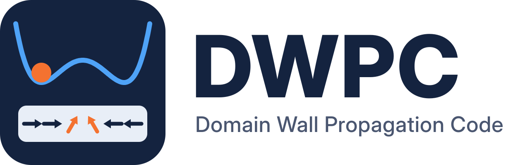

# DWPC
This code is dedicated to simulate a 1D domain-wall propagation into a nano-strip with two notches or anti-notches wich give power law pinning energy. The domain wall is driven by an oscillating magnetic field between the notches. The roles of notches/anti-notches is to give a non-linear oscillation response similar to a Duffing oscillator. 

As an extension of this, the dynamics of the DW can be applied to reproduce the multiplexing of a signal into a Recurrent Neural Netword (RNN) in order to obtain a classification of different input signals.

# User manual
The user manual (PDF) is in [docs/manual/dwpc_manual.pdf](docs/manual/dwpc_manual.pdf); the LaTeX source and figure scripts are in the same folder.

# Installing DWPC
DWPC requires to be run on Linux OS using g++ compiler. The installation can be done by cloning github repository as follow:

"git clone https://github.com/maxxwave/DWPC.git"

Once this is downloaded in your local Linux computer you can run the installation script following:

"cd DWPC"
&
"sh makefile.sh"

# Using DWPC
The parameters can be changed from the input file. An example comes with the package. The user must be aware of respecting the format of the input file. No space is allowed between the name of the variable and "=" and between "=" and the value.

Note: All variables are set in SI units

# Laser / thermal extension
Temperature-dependent parameters, a two-temperature model for ultrafast laser heating, multi-wire fixes and cluster scripts are described in [docs/LASER_THERMAL.md](docs/LASER_THERMAL.md).

# Licence and citation
DWPC is free software, distributed under the GNU General Public License, version 3 or later (see [LICENSE](LICENSE)). You may use, study, modify and redistribute it, but any distributed modified version must remain under the same licence, keep the copyright notices and make its source code available.

Copyright (C) 2019-2026 Razvan-Vasile Ababei and Matt Ellis.

If you use DWPC in published work, please cite it as described in [CITATION.cff](CITATION.cff), in particular:

R. V. Ababei, M. O. A. Ellis, I. T. Vidamour, D. S. Devadasan, D. A. Allwood, E. Vasilaki and T. J. Hayward, *Neuromorphic computation with a single magnetic domain wall*, Sci. Rep. **11**, 15587 (2021). https://doi.org/10.1038/s41598-021-94975-y

# Acknowledgements
Parts of the laser/thermal extension, the tests and the user manual were prepared with the help of an AI assistant (Claude, Anthropic), under the direction of the developers. The AI assistant is not a developer or author of DWPC.
